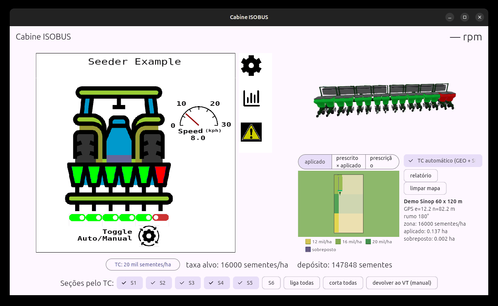
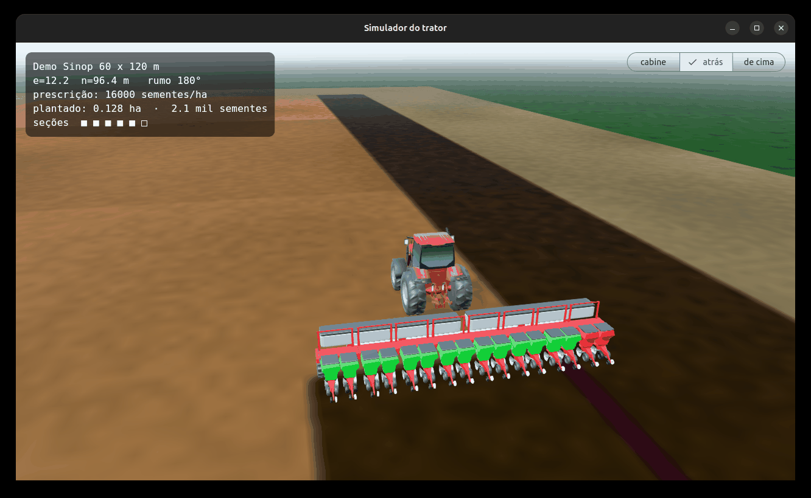

# Cabine ISOBUS em Flutter

[](https://github.com/jmfdev6/devfest-isobus-flutter/actions/workflows/ci.yml)
[](https://jmfdev6.github.io/devfest-isobus-flutter/)
[](LICENSE)

**O computador de bordo de um trator, feito em Flutter, rodando no seu notebook. Não precisa de trator nenhum.**

Este projeto foi apresentado ao vivo no **DevFest Cerrado Nortão 2026**. Ele é aberto (open source): qualquer pessoa pode baixar, rodar, estudar e melhorar.

| A cabine (a tela do trator) | O simulador (você dirige) |
|---|---|
|  |  |
| O Task Controller manda a taxa da zona (16 mil/ha) e corta a seção 6, que passaria sobre o que já foi plantado. | A mesma cena em 3D: cinco seções plantando (potes verdes) e a sexta cortada (vermelho). |

> 📘 **Quer os detalhes técnicos?** A documentação completa (arquitetura, mensagens CAN, algoritmos) está em **<https://jmfdev6.github.io/devfest-isobus-flutter/>**. Este README é o guia para começar.

---

## Sumário

- [O que é isso, em palavras simples](#o-que-é-isso-em-palavras-simples)
- [O que você vai ver funcionando](#o-que-você-vai-ver-funcionando)
- [Do que você precisa](#do-que-você-precisa)
- [Instalação, passo a passo](#instalação-passo-a-passo)
- [Como dirigir o trator](#como-dirigir-o-trator)
- [Outras coisas para testar](#outras-coisas-para-testar)
- [Se der errado](#se-der-errado)
- [Glossário](#glossário)
- [Como o código está organizado](#como-o-código-está-organizado)
- [Como contribuir](#como-contribuir) · [Licença](#licença) · [Créditos](#créditos)

---

## O que é isso, em palavras simples

Um trator moderno não é só motor e rodas. Dentro dele há vários pequenos computadores: o do motor, o do GPS, o da plantadeira que ele puxa... E eles **conversam entre si por um fio**, o tempo todo, como um grupo de mensagens.

- Esse "fio de conversa" se chama **rede CAN**.
- A "língua" que tratores e máquinas agrícolas de marcas diferentes usam nessa conversa se chama **ISOBUS** (é uma norma internacional, a ISO 11783).
- Na cabine fica uma **tela** (o "monitor" do operador). É por ela que o operador vê e comanda a plantadeira.

Este projeto é essa **tela da cabine**, feita com **Flutter** (a ferramenta do Google para criar apps). Para você não precisar de um trator de verdade, o projeto também cria:

- uma **rede CAN de mentira** (virtual) dentro do seu computador;
- uma **plantadeira de mentira**, que entra na rede e manda a tela dela para a cabine;
- um **trator de mentira em 3D**, que você dirige pelo teclado. Ele manda a posição do GPS para a cabine, como um trator real.

A cabine então faz o que um monitor agrícola de verdade faz: mostra a tela da plantadeira, **escolhe quanta semente plantar em cada parte do campo** (seguindo um mapa) e **desliga as partes da plantadeira** que passariam por cima do que já foi plantado. Isso evita desperdício de semente.

## O que você vai ver funcionando

- 🖥️ **A tela da plantadeira** dentro do app: botões, medidor de velocidade, funis verdes (plantando) ou vermelhos (desligados).
- 🌱 **O Task Controller trabalhando**: a taxa muda sozinha conforme a zona do campo (TC-GEO) e as seções cortam na cabeceira e onde já foi plantado (TC-SEC).
- 🚜 **O simulador**: você dirige o trator e planta o campo, vendo a semente cair no chão em 3D.

---

## Do que você precisa

| Item | Detalhe |
|---|---|
| **Computador com Linux** | Ubuntu 22.04 ou mais novo (ou Debian). É o Linux que tem a rede CAN virtual. |
| **Windows?** | Use o [WSL2](https://learn.microsoft.com/pt-br/windows/wsl/install) com Ubuntu. Funciona, mas é mais chato (veja [Se der errado](#se-der-errado)). |
| **Mac?** | Não funciona: o macOS não tem rede CAN virtual. |
| **Espaço em disco** | uns 10 GB (o Flutter e a compilação ocupam bastante). |
| **Internet** | só na primeira vez, para baixar tudo. |
| **Tempo** | uns 30 minutos na primeira vez (a maior parte é esperar compilar). |

Você **não** precisa saber programar para rodar a demo. Basta copiar e colar os comandos abaixo, um de cada vez.

---

## Instalação, passo a passo

### Passo 1: abra um terminal

O terminal é a janela onde você digita comandos. No Ubuntu, aperte **Ctrl + Alt + T**.

> 💡 Para colar um comando no terminal, use **Ctrl + Shift + V** (não é só Ctrl + V).

### Passo 2: instale os programas do sistema

Cole o comando abaixo e aperte Enter. Ele vai pedir a **sua senha** (ao digitar, nada aparece na tela, é normal).

```bash
sudo apt update && sudo apt install -y git curl build-essential cmake ninja-build pkg-config libgtk-3-dev can-utils
```

✅ **Deu certo se** o terminal terminar sem a palavra `E:` (de erro) nas últimas linhas.

### Passo 3: instale o mise (ele baixa o Flutter certo para você)

O projeto precisa de uma versão específica do Flutter (3.47.9). O **mise** cuida disso sozinho. Cole uma linha de cada vez:

```bash
curl https://mise.run | sh
echo 'eval "$(~/.local/bin/mise activate bash)"' >> ~/.bashrc
```

Agora **feche o terminal e abra outro** (Ctrl + Alt + T), para ele enxergar o mise.

✅ **Deu certo se** `mise --version` mostrar um número de versão.

> Já tem o Flutter 3.47.9 instalado do jeito tradicional? Pode pular este passo.

### Passo 4: baixe o projeto

```bash
git clone --recurse-submodules https://github.com/jmfdev6/devfest-isobus-flutter.git
cd devfest-isobus-flutter
```

✅ **Deu certo se** o comando `ls` mostrar arquivos como `demo.sh` e `README.md`.

### Passo 5: prepare tudo (um comando só)

```bash
./demo.sh preparar
```

Este comando baixa o Flutter certo e compila as três partes: a parte em C++, que conversa com a rede, e os dois apps. **Demora** (de 10 a 20 minutos na primeira vez). Vá tomar um café ☕.

✅ **Deu certo se** a última linha for: `pronto. Agora: ./demo.sh iniciar`

### Passo 6: ligue a demo

```bash
./demo.sh iniciar
```

Este comando cria a rede CAN virtual e liga a cabine, a plantadeira e o simulador, nessa ordem. Não precisa de senha.

✅ **Deu certo se** abrirem **duas janelas**: a **"Cabine ISOBUS"** (com a tela da plantadeira, a *Seeder Example*) e o **"Simulador do trator"** (com o trator em 3D). As duas janelas abrem uma em cima da outra: arraste uma para o lado.

> A primeira janela pode demorar uns 10 segundos para mostrar a tela da plantadeira. A plantadeira espera a cabine "se apresentar" na rede antes de mandar a tela.

### Passo 7: dirija!

Clique na janela do **simulador** e aperte **W** para acelerar. Use **A** e **D** para virar. Veja na cabine o mapa sendo pintado e os funis da plantadeira ligando e desligando sozinhos. Mais comandos na [próxima seção](#como-dirigir-o-trator).

### Passo 8: desligue

Quando terminar, volte ao terminal e digite:

```bash
./demo.sh parar
```

Na próxima vez, basta entrar na pasta e iniciar (os passos 1 a 5 são só na primeira vez):

```bash
cd devfest-isobus-flutter
./demo.sh iniciar
```

---

## Como dirigir o trator

Clique na janela do simulador antes, para o teclado ir para ela.

| O que fazer | Tecla | Na tela |
|---|---|---|
| acelerar | **W** ou ↑ | — |
| frear | **S**, ↓ ou espaço | — |
| virar o volante | **A** / **D** ou ← / → | arraste o volante desenhado |
| acelerador de mão (fica ligado sozinho) | **E** põe, **Q** tira | a alavanca "acelerador" |
| frente / ré (com o trator parado) | **R** | botão F → R |
| trocar a câmera (cabine, atrás, de cima) | **C** | botões no canto |

---

## Outras coisas para testar

| Comando | O que faz |
|---|---|
| `./demo.sh iniciar --automatico` | ninguém dirige: o trator anda sozinho e você só assiste. Bom para deixar rodando num telão. |
| `./demo.sh status` | mostra o que está ligado. |
| `./demo.sh testar` | roda todos os testes automáticos (leva uns 3 minutos e termina com `tudo certo`). |
| `./demo.sh rede` | abre um terminal "dentro" da rede da demo; lá, `candump vcan0` mostra as mensagens passando. |

Os registros de cada programa ficam na pasta `.demo/` (por exemplo, `.demo/cabine.log`).

---

## Se der errado

| O que aconteceu | O que fazer |
|---|---|
| `./demo.sh: Permissão negada` | Rode `chmod +x demo.sh scripts/*.sh` e tente de novo. |
| `falta o cmake` (ou `git`, `pkg-config`) | Faltou o [passo 2](#passo-2-instale-os-programas-do-sistema). |
| `falta o Flutter` / `flutter: command not found` | Faltou o [passo 3](#passo-3-instale-o-mise-ele-baixa-o-flutter-certo-para-você), ou você não abriu um terminal novo depois dele. |
| `não deu para criar a rede` + "AppArmor" | O Ubuntu 24.04 bloqueia a rede sem senha. Rode o comando que a mensagem sugere (`sudo sysctl -w kernel.apparmor_restrict_unprivileged_userns=0`) ou crie a rede com senha: `./scripts/setup_vcan.sh`. |
| `Module vcan not found` (comum no WSL) | O seu Linux não tem a rede CAN virtual. No Ubuntu: `sudo apt install linux-modules-extra-$(uname -r)`. No WSL, é preciso um kernel com `vcan` ([detalhes na documentação](https://jmfdev6.github.io/devfest-isobus-flutter/problemas/)). |
| `a plantadeira não conectou ao TC` | Rode `./demo.sh parar` e `./demo.sh iniciar` de novo. Se repetir, veja o fim de `.demo/cabine.log`. |
| A tela da plantadeira ficou estranha (switches não mudam) | `./demo.sh parar` e `./demo.sh iniciar`. A cabine e a plantadeira precisam ligar juntas, nessa ordem. |
| O trator não anda | Clique na janela do simulador e aperte **W** (ou **E**, o acelerador de mão). |
| O 3D aparece em branco | Confira se está usando o Flutter do projeto: `./demo.sh preparar` de novo. |
| Quero plantar o campo de novo do zero | `./demo.sh iniciar` de novo (no simulador, o botão **replantar** limpa só o chão dele). |

Não resolveu? Abra uma [issue](https://github.com/jmfdev6/devfest-isobus-flutter/issues) contando o que fez e colando a mensagem de erro. A [lista completa de problemas](https://jmfdev6.github.io/devfest-isobus-flutter/problemas/) está na documentação.

---

## Glossário

| Termo | Em palavras simples |
|---|---|
| **CAN** | O "fio de conversa" entre os computadores de um veículo. Cada mensagem é curtinha (8 bytes). |
| **vcan0** | Uma rede CAN de mentira, dentro do Linux, para testar sem hardware. |
| **ISOBUS** (ISO 11783) | A "língua comum" das máquinas agrícolas: um trator de uma marca entende a plantadeira de outra. |
| **J1939** | A norma de caminhões em que o ISOBUS se baseia (endereços, mensagens do motor). |
| **ECU** | Cada computador da rede (o motor, o GPS, a plantadeira, a cabine). |
| **VT** (Terminal Virtual) | A tela da cabine. A plantadeira manda o "desenho" da tela dela, e o VT mostra. |
| **TC** (Task Controller) | O "gerente de tarefas" da cabine: manda a plantadeira aplicar tal taxa, ligar ou desligar seções. |
| **Seção** | Um pedaço da plantadeira que liga e desliga separado (aqui são 6). |
| **Taxa** | Quanta semente por hectare (por exemplo, 16 mil sementes/ha). |
| **Talhão** | Um pedaço de lavoura com contorno definido. |
| **Prescrição** (mapa de prescrição) | O mapa que diz qual taxa usar em cada parte do talhão. |
| **Mapa de aplicação** | O mapa do que foi feito de verdade: onde e quanta semente caiu. |
| **TC-GEO** | A cabine troca a taxa sozinha conforme o GPS e o mapa de prescrição. |
| **TC-SEC** | A cabine desliga sozinha as seções que sairiam do talhão ou passariam no já plantado. |
| **NMEA 2000** | O jeito padrão de o GPS mandar a posição pela rede CAN. |
| **UTM** | Um jeito de escrever coordenadas em metros, em vez de graus. |
| **Flutter / Dart** | A ferramenta do Google para criar apps, e a linguagem dela. |
| **FFI** | O jeito de o Dart chamar código escrito em C/C++. |
| **AgIsoStack++** | A biblioteca aberta em C++ que "fala ISOBUS". Este projeto a usa por baixo. |

---

## Como o código está organizado

```
apps/cabine/       o app da cabine (Flutter): tela do VT e TC
apps/simulador/    o simulador 3D (Flutter): física e volante
pacotes/agiso/     a ponte Dart ↔ C, o talhão e o TC automático
pacotes/cena/      os modelos 3D e o mapa, usados pelos dois apps
nativo/            a parte em C++: a ponte com a AgIsoStack++, o trator e a plantadeira
scripts/           a rede virtual e os testes automáticos
demo.sh            prepara, liga, desliga e testa tudo
```

Quer entender como as peças conversam? Comece pela [arquitetura](https://jmfdev6.github.io/devfest-isobus-flutter/arquitetura/). Para refazer a palestra passo a passo, sem o `demo.sh`, siga o [roteiro da palestra](https://jmfdev6.github.io/devfest-isobus-flutter/palestra/).

---

## Como contribuir

Contribuições são bem-vindas, principalmente de quem está começando! Leia o [CONTRIBUTING.md](CONTRIBUTING.md) e o [Código de Conduta](CODE_OF_CONDUCT.md). Antes de abrir um pull request, rode `./demo.sh testar`.

## Licença

[MIT](LICENSE). A AgIsoStack++ também é MIT, © The Open-Agriculture Developers.

## Créditos

- [Open-Agriculture / AgIsoStack++](https://github.com/Open-Agriculture/AgIsoStack-plus-plus), a pilha ISOBUS que faz o trabalho pesado.
- GDG / DevFest Cerrado Nortão.
