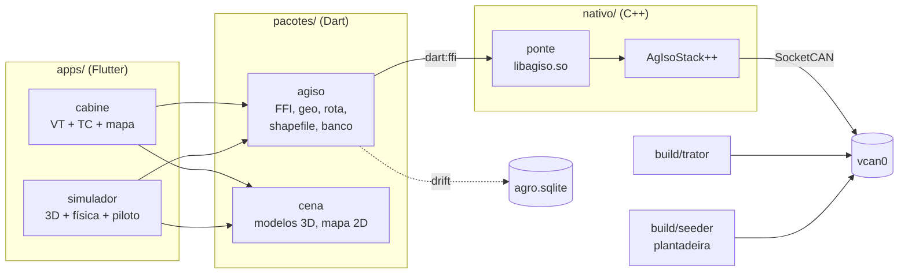
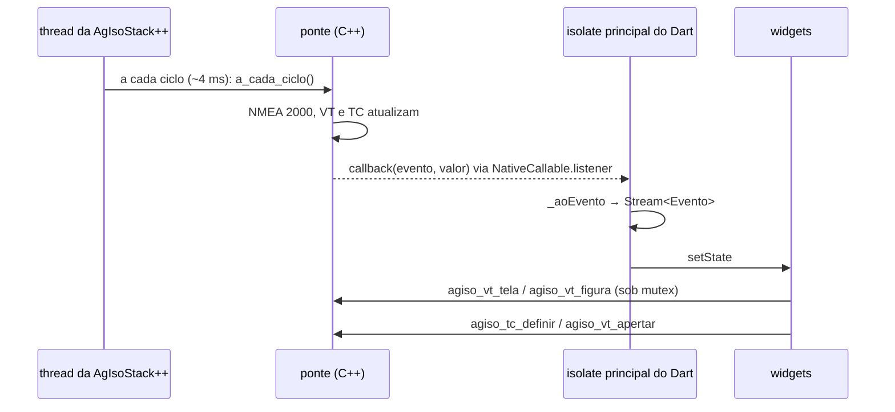
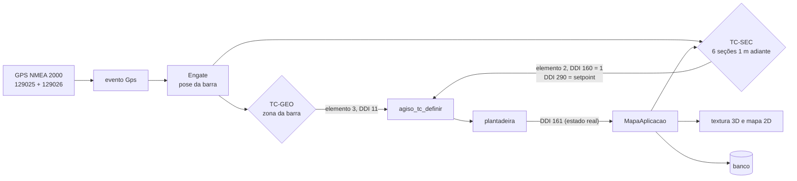

# Arquitetura

## Camadas

A regra principal: **só a ponte conhece a AgIsoStack++.** O Dart vê um contrato C pequeno ([`agiso.h`](ponte.md)) com funções que recebem e devolvem tipos simples (inteiros, `double`, *buffers*). Assim o FFI fica trivial e a pilha pode mudar sem tocar no Dart.

| Pasta | Linguagem | Responsabilidade |
|---|---|---|
| `nativo/ponte/` | C++17 | `libagiso.so`: rede, NMEA 2000, VT *server*, TC *server*, eventos para o Dart |
| `nativo/trator/` | C++17 | trator automático (GPS NMEA 2000, `0xFE49`, EEC1) num talhão fixo |
| `nativo/plantadeira/` | C++17 | cópia do *seeder example* da AgIsoStack++: VT *client*, TC *client*, 6 seções |
| `nativo/teste/` | C | usa a ponte sem Dart (prova que o contrato basta) |
| `pacotes/agiso/` | Dart puro | classe `Agiso`, talhão, TC automático, rota, shapefile, relatório, banco; a cabine em modo texto |
| `pacotes/cena/` | Flutter | modelos `.glb`, cenas do flutter_scene, mapa 2D e legenda |
| `apps/cabine/` | Flutter | o terminal: desenha o VT, painel do TC, plantadeira 3D, mapa ao vivo |
| `apps/simulador/` | Flutter | o trator dirigível, piloto automático, importação de shapefile, trabalhos |

## Processos na demo

| Processo | Papel na rede | Endereço | Modo da ponte |
|---|---|---|---|
| `cabine` | VT *server* + TC *server* | `0x81` | `agiso_start` |
| `seeder` (plantadeira) | VT *client* + TC *client* | `0x80` | — (AgIsoStack++ direto) |
| `simulador` | trator: GPS, velocidade, rotação | `0x01` | `agiso_start_trator` |
| `simulador --ouvinte` | só escuta | `0x90` | `agiso_start_ouvinte` |
| `trator` | trator automático | `0x01` | — (AgIsoStack++ direto) |

Simulador dirigível e `./build/trator` **não** rodam juntos: seriam dois tratores com o mesmo papel.

Cada ECU da ponte tem um NAME ISO 11783-5 próprio: grupo de indústria 2 (agricultura), fabricante 1407, número de identidade 2026 (cabine), 2031 (ouvinte) ou 2032 (trator), função *Rate Control* ou 134 (trator), e *arbitrary address capable*. Assim os três podem coexistir no mesmo barramento sem disputar o endereço.

## Threads

- A AgIsoStack++ roda **suas próprias threads** (recepção de quadros e atualização periódica). A ponte se pendura no `periodic_update_event_dispatcher` e faz tudo nesse ciclo.
- Os eventos sobem para o Dart por um `NativeCallable.listener`: o C pode chamar **de qualquer thread**, e a chamada vira uma mensagem na fila do isolate. Não há bloqueio nem acesso ao heap do Dart fora do isolate.
- O caminho contrário é **síncrono**: o Dart chama funções C que pegam um `std::mutex`, copiam o estado (tela JSON, figura, setpoint) e retornam.
- O trator (simulador) chama `agiso_trator_mover` a cada quadro; a ponte guarda o estado sob mutex e a thread da pilha o envia no ritmo de cada mensagem.

## Fluxo de dados do TC automático

O mapa de aplicação é preenchido pelo **estado real** que a plantadeira informa (DDI 161), não pelo que o TC pediu. Se o operador desliga um switch, o mapa mostra a falha. Detalhes em [Task Controller](tc.md) e [Mapa de aplicação](mapa-aplicacao.md).

## Leitura sugerida do código

1. [`nativo/ponte/agiso.h`](https://github.com/jmfdev6/devfest-isobus-flutter/blob/main/nativo/ponte/agiso.h): o contrato
2. [`nativo/teste/teste.c`](https://github.com/jmfdev6/devfest-isobus-flutter/blob/main/nativo/teste/teste.c): o contrato usado em C puro
3. [`nativo/ponte/agiso.cpp`](https://github.com/jmfdev6/devfest-isobus-flutter/blob/main/nativo/ponte/agiso.cpp): rede, NMEA 2000, modos
4. [`pacotes/agiso/lib/agiso.dart`](https://github.com/jmfdev6/devfest-isobus-flutter/blob/main/pacotes/agiso/lib/agiso.dart): o FFI
5. [`apps/cabine/lib/main.dart`](https://github.com/jmfdev6/devfest-isobus-flutter/blob/main/apps/cabine/lib/main.dart): o app
6. [`nativo/ponte/vt.cpp`](https://github.com/jmfdev6/devfest-isobus-flutter/blob/main/nativo/ponte/vt.cpp) → [`apps/cabine/lib/tela_vt.dart`](https://github.com/jmfdev6/devfest-isobus-flutter/blob/main/apps/cabine/lib/tela_vt.dart): o VT
7. [`nativo/ponte/tc.cpp`](https://github.com/jmfdev6/devfest-isobus-flutter/blob/main/nativo/ponte/tc.cpp) → [`pacotes/agiso/lib/geo.dart`](https://github.com/jmfdev6/devfest-isobus-flutter/blob/main/pacotes/agiso/lib/geo.dart): o TC

Os comentários `// [passo N]` … `// [/passo N]` marcam o que cada etapa da [palestra](palestra.md) acrescentou.
