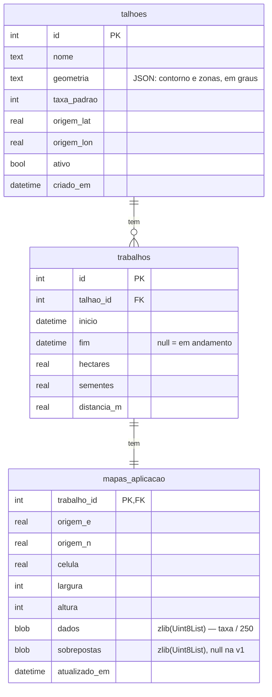

# Banco de dados (drift)

Talhões, trabalhos e mapas de aplicação ficam num SQLite local, via [drift](https://pub.dev/packages/drift) **2.35.4** e [sqlite3](https://pub.dev/packages/sqlite3) **3.9.2**. O SQLite vem embutido pelo pacote (*build hooks*): não há nada a instalar no sistema.

```text
$XDG_DATA_HOME/cabine-isobus/agro.sqlite     (padrão: ~/.local/share/cabine-isobus/agro.sqlite)
```

Código: [`pacotes/agiso/lib/banco.dart`](https://github.com/jmfdev6/devfest-isobus-flutter/blob/main/pacotes/agiso/lib/banco.dart). O `banco.g.dart` gerado vai no repositório.

## Um arquivo, dois processos

A **cabine** e o **simulador** abrem o mesmo arquivo ao mesmo tempo:

```dart
NativeDatabase.createInBackground(arquivo, setup: (db) {
  db.execute('PRAGMA journal_mode = WAL');   // um lê enquanto o outro escreve
  db.execute('PRAGMA busy_timeout = 5000');  // espera a vez em vez de falhar
});
```

O simulador importa o shapefile e marca o talhão como **ativo**. A cabine pergunta `idTalhaoAtivo()` a cada 2 s, uma consulta barata, e, se mudou, carrega o talhão e passa a usar a prescrição dele no TC-GEO. Com `--talhao-demo`, a cabine não usa o banco.

## Esquema (v2)



- A **geometria** é guardada em graus. Ao ler, a origem é a guardada, então o mapa de aplicação, que está em metros, continua alinhado.
- Os **blobs** são a grade do [`MapaAplicacao`](mapa-aplicacao.md) comprimida com zlib. A grade é quase toda zeros ou valores repetidos, então comprime muito.
- Há **um mapa por trabalho** (chave primária = `trabalho_id`); salvar é um *upsert*.

## API

| Método | Descrição |
|---|---|
| `Banco.abrir([caminho])` | abre ou cria o arquivo |
| `salvarTalhao(t)` | insere e marca como ativo (desmarca os outros), numa transação |
| `ativarTalhao(id)`, `idTalhaoAtivo()` | o talhão da cabine |
| `talhao(id)`, `listarTalhoes()` | leitura |
| `iniciarTrabalho(talhaoId)`, `trabalhoAberto(talhaoId)`, `trabalhosDo(talhaoId)` | trabalhos |
| `salvarTrabalho(id, mapa, distancia:, encerrar:)` | grava o mapa e os totais; encerra o trabalho se pedido |
| `reabrirTrabalho(id)` | volta a um trabalho encerrado (encerra o aberto do mesmo talhão) |
| `mapaDoTrabalho(id)` | a grade descomprimida |

## Migrações

```dart
@override
int get schemaVersion => 2;

@override
MigrationStrategy get migration => MigrationStrategy(
  onUpgrade: (m, de, para) async {
    if (de < 2) await m.addColumn(mapasAplicacao, mapasAplicacao.sobrepostas);
  },
);
```

Para mudar o esquema: altere as tabelas, **suba `schemaVersion`**, acrescente o passo em `onUpgrade` e regenere:

```bash
cd pacotes/agiso && dart run build_runner build
```

## Ferramentas

```bash
cd pacotes/agiso
dart run bin/banco.dart             # lista talhões (o ativo com *) e trabalhos
dart run bin/banco.dart verificar   # ida e volta num banco temporário (inclui sobreposição)
```

Para começar do zero, com os apps fechados: `rm -f ~/.local/share/cabine-isobus/agro.sqlite*` (o `*` pega os arquivos `-wal` e `-shm`).
