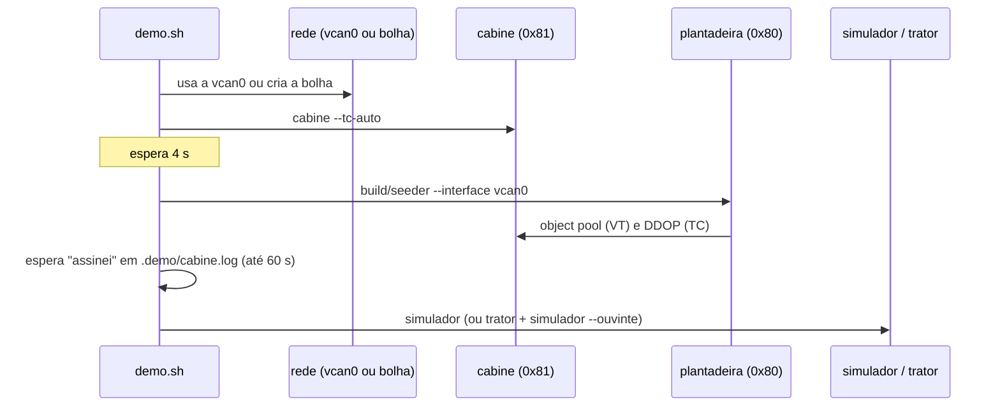

# demo.sh e testes

O [`demo.sh`](https://github.com/jmfdev6/devfest-isobus-flutter/blob/main/demo.sh) é a porta de entrada: prepara, liga, desliga e testa.

| Comando | O que faz |
|---|---|
| `./demo.sh preparar` | submódulo, Flutter do mise, C++ (CMake), `pub get` e build release dos dois apps |
| `./demo.sh iniciar [opções]` | rede, cabine, plantadeira e simulador, na ordem certa |
| `./demo.sh parar` | mata os processos guardados em `.demo/*.pid` e destrói a bolha |
| `./demo.sh status` | o que está rodando e em qual rede |
| `./demo.sh testar [--rapido]` | análise estática, autotestes e os testes com a rede CAN |
| `./demo.sh rede` | um shell dentro da rede da demo (útil na bolha) |

## iniciar

```bash
./demo.sh iniciar                     # você dirige
./demo.sh iniciar --automatico        # o ./build/trator dirige; o simulador só assiste (--ouvinte)
./demo.sh iniciar --sem-tc            # a cabine abre com o TC automático desligado
./demo.sh iniciar --talhao exemplos/talhao_sinop.shp
./demo.sh iniciar --talhao exemplos/contorno_sinop_utm.shp \
    --prescricao exemplos/prescricao_sinop.shp --campo DOSE_MIL --fator 1000
```

Opções que o `demo.sh` não conhece vão para o simulador. A sequência:



!!! info "Por que a cabine sobe antes da plantadeira"
    O cliente de VT da plantadeira guarda o último valor que enviou para cada objeto. Se a cabine reinicia depois, ela recebe o *object pool* com os valores iniciais, e a plantadeira não reenvia o que acha que já mandou: switches e funis ficam dessincronizados. **Reiniciou a cabine? Reinicie a plantadeira.** O `iniciar` já faz isso, porque chama `parar` antes.

No modo `--automatico`, a cabine recebe `--talhao-demo` para usar o talhão 60 × 120 m que o `./build/trator` percorre, em vez do talhão ativo do banco.

Registros e PIDs ficam em `.demo/` (`cabine.log`, `plantadeira.log`, `simulador.log`, `trator.log`, `rede`).

## Opções dos apps

| App | Opção | Efeito |
|---|---|---|
| cabine | `--tc-auto` | TC automático (GEO + SEC) já ligado |
| cabine | `--talhao-demo` | usa o talhão da demo, sem ler o banco |
| simulador | `--ouvinte` | não é o trator: só acompanha o GPS da rede |
| simulador | `--talhao C.shp` | importa um shapefile ao abrir |
| simulador | `--prescricao P.shp` | prescrição em arquivo separado |
| simulador | `--campo NOME` | o campo do `.dbf` com a taxa |
| simulador | `--fator F` | multiplica o campo para virar sementes/ha (mil/ha = 1000; sementes/m² = 10000) |

## testar

```bash
./demo.sh testar            # tudo (~3 min)
./demo.sh testar --rapido   # pula o autoteste do piloto
```

| Etapa | Comando | Confere |
|---|---|---|
| análise | `dart analyze` (pacote `agiso`) | sem avisos |
| shapefile | `dart run bin/shapefile.dart` | leitura, UTM → graus, prescrição separada, exportação e releitura |
| banco | `dart run bin/banco.dart verificar` | ida e volta num banco temporário, incluindo 40 células sobrepostas |
| física | `dart --enable-asserts lib/fisica.dart` | aceleração, freio, raio de giro, ré |
| piloto | `dart --enable-asserts lib/piloto.dart` | a rota inteira nos dois talhões sem sair do contorno |
| TC | `scripts/teste_tc.sh` | DDOP, assinatura, taxa alvo, controle de seções, depósito |
| GEO/SEC | `scripts/teste_geo.sh` | GPS NMEA 2000, taxa por zona, corte na cabeceira e na sobreposição |

Os dois testes de rede criam **a própria bolha** (com um `XDG_RUNTIME_DIR` temporário), então rodam mesmo com a demo ligada em outra rede. Eles leem a saída da cabine em modo texto (`pacotes/agiso/bin/main.dart`) e procuram linhas como:

```text
TC  | DDOP recebido de 0x80
TC  | assinei 17 valores
TC  | Actual Work State 1-16 (2/161) = -2731
DART| GEO taxa da zona: 20000
DART| SEC seções pedidas ■■■■■□
```

`-2731` é `0xFFFFF555` como `int32`: seções 1 a 6 em `01` (ligadas) e 7 a 16 em `11` (não existem). Veja [Task Controller](tc.md#estado-das-secoes).

## CI

O [`ci.yml`](https://github.com/jmfdev6/devfest-isobus-flutter/blob/main/.github/workflows/ci.yml) roda em cada push e PR: checkout com submódulos, `ninja-build` e `libgtk-3-dev`, Flutter 3.47.9, `./demo.sh preparar`, `dart analyze` e `flutter analyze` nos três pacotes Flutter, e os autotestes de shapefile, banco, física e piloto. Os testes com a rede CAN ficam de fora: os *runners* do GitHub não têm `vcan`.

O site desta documentação é publicado pelo [`docs.yml`](https://github.com/jmfdev6/devfest-isobus-flutter/blob/main/.github/workflows/docs.yml) a cada push na `main` que mexa em `docs/` ou no `mkdocs.yml`. Para ver localmente:

```bash
pip install mkdocs-material
mkdocs serve        # http://127.0.0.1:8000
```
