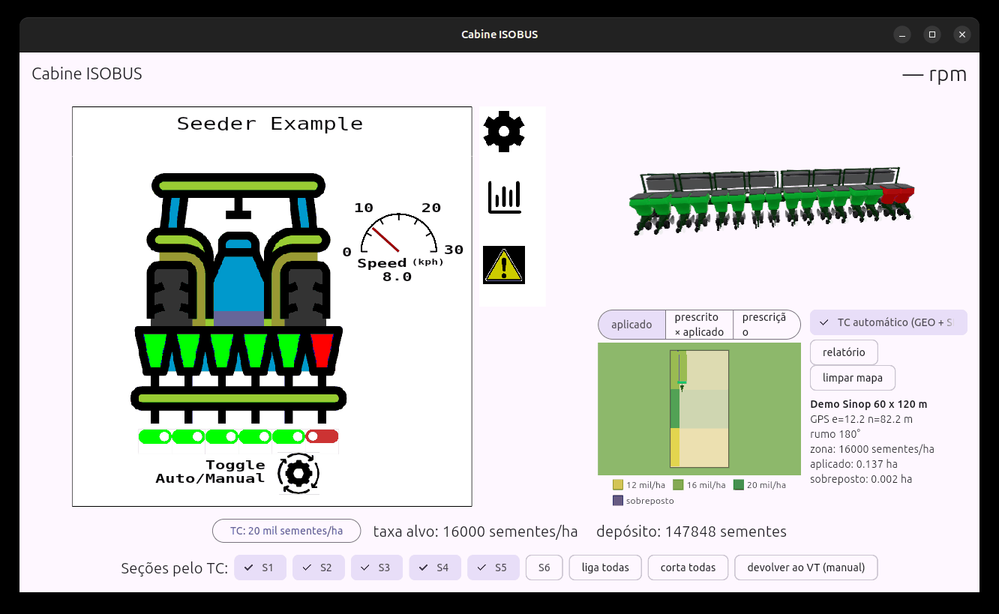
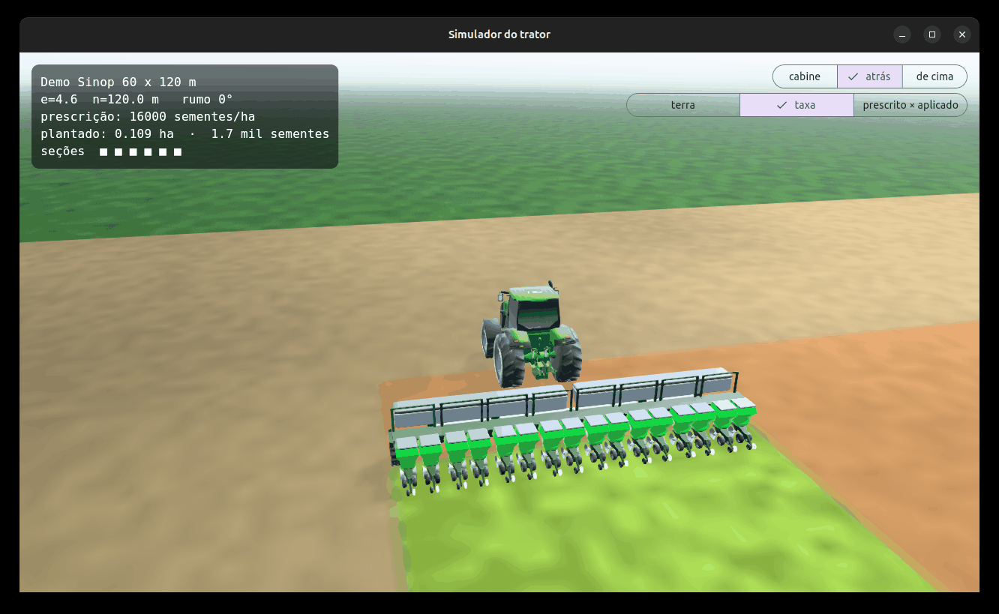

# Cabine ISOBUS em Flutter

Documentação técnica do projeto apresentado no **DevFest Cerrado Nortão 2026**: um app **Flutter** para Linux que entra na rede de um trator (**ISOBUS / J1939 sobre CAN**) usando a pilha C++ [AgIsoStack++](https://github.com/Open-Agriculture/AgIsoStack-plus-plus) por **Dart FFI**, com um simulador 3D do trator e da plantadeira.

!!! tip "Primeira vez aqui?"
    Se você só quer **rodar a demo**, o [README](https://github.com/jmfdev6/devfest-isobus-flutter#readme) tem o passo a passo para iniciantes. Esta documentação é para quem quer **entender e modificar** o código.

| Cabine | Simulador |
|---|---|
|  |  |

## O que o sistema faz

- **Terminal Virtual (VT, ISO 11783-6):** recebe o *object pool* de um implemento, transforma cada máscara em uma lista de desenho JSON e a desenha em Flutter (textos, retângulos, elipses, linhas, figuras, medidores, soft keys). Toques voltam ao implemento como ativações de botão ou de soft key.
- **Task Controller (TC, ISO 11783-10):** recebe o DDOP, assina os valores do implemento e envia *setpoints* (taxa alvo, estado das seções).
- **TC-GEO e TC-SEC automáticos:** com a posição do GPS (NMEA 2000), escolhe a taxa pelo mapa de prescrição e corta as seções fora do talhão ou sobre área já plantada.
- **Simulador 3D** ([flutter_scene](https://pub.dev/packages/flutter_scene)): é o trator na rede (GPS NMEA 2000, velocidade de solo, rotação do motor), com física de bicicleta, plantadeira rebocada e piloto automático por *pure pursuit*.
- **Shapefile** (leitura e escrita, graus e UTM), **mapa de aplicação**, relatório prescrito × aplicado e persistência local com **drift** (SQLite).

## Mapa da documentação

| Quero... | Leia |
|---|---|
| instalar e rodar | [Instalação](instalacao.md), [demo.sh e testes](demo.md) |
| refazer a palestra, comando por comando | [Roteiro da palestra](palestra.md) |
| entender as camadas e as threads | [Arquitetura](arquitetura.md) |
| chamar a pilha ISOBUS a partir do Dart | [Ponte C e Dart FFI](ponte.md) |
| saber o que trafega na rede | [Rede CAN e mensagens](rede-can.md) |
| mexer no desenho da tela do implemento | [Terminal Virtual](vt.md) |
| entender DDOP, DDIs e o corte de seções | [Task Controller](tc.md) |
| importar ou exportar mapas | [Talhão e shapefile](talhao.md), [Mapa de aplicação](mapa-aplicacao.md) |
| mudar o planejamento de rota | [Rota e piloto automático](piloto.md) |
| ajustar a física ou o controle USB | [Simulador e física](simulador.md) |
| mexer no 3D | [3D com flutter_scene](3d.md) |
| mudar as tabelas | [Banco de dados](banco.md) |

## Números de referência

| | |
|---|---|
| Plataforma | Linux (SocketCAN); Flutter 3.47.9 / Dart 3.13.7 (fixados no `mise.toml`) |
| Endereços na rede | cabine `0x81`, trator `0x01`, ouvinte `0x90`, plantadeira `0x80` (*arbitrary address capable*) |
| Plantadeira | barra de 9,144 m em 6 seções, 5 m atrás da antena |
| Mapa de aplicação | grade de no mínimo 0,5 m, 1 byte por célula (taxa / 250) |
| Ritmo do trator | GPS NMEA 2000 no ritmo da norma; `0xFE49` e EEC1 a cada 100 ms |
