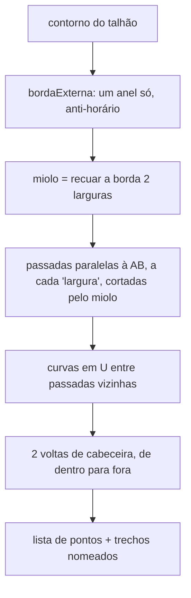

# Rota e piloto automático

O piloto automático tem duas partes: o **planejador** ([`pacotes/agiso/lib/rota.dart`](https://github.com/jmfdev6/devfest-isobus-flutter/blob/main/pacotes/agiso/lib/rota.dart)), que calcula uma rota que cobre o talhão sem sair dele, e o **condutor** ([`apps/simulador/lib/piloto.dart`](https://github.com/jmfdev6/devfest-isobus-flutter/blob/main/apps/simulador/lib/piloto.dart)), um motor elétrico no volante que segue a rota.

## Planejamento

`Rota.planejar(talhao, a:, b:, largura: 9,144, voltasCabeceira: 2, recuo: 5, folga: 0,3)`



### 1. Borda e cabeceira

`bordaExterna` junta, ponta com ponta, as arestas que têm talhão de **um lado só**. Assim um talhão que vem dividido em zonas vira um contorno único. Vértices colineares são removidos.

`recuar(anel, d)` desloca cada aresta `d` metros para dentro; os novos cantos são as interseções das arestas deslocadas. O **miolo** é a borda recuada de `2 × largura`: a cabeceira, faixa onde o trator manobra e que é plantada no fim.

### 2. Passadas

Com `d` = direção unitária de A→B e `normal` = `d` girada 90° à direita, cada passada `k` é a reta `A + k·largura·normal + t·d`. Ela é cortada pelo miolo (interseção reta × anel, pares de `t` de entrada e saída). Passadas que o miolo não corta, ou com menos de 2 m, são descartadas. As passadas alternam de sentido. A AB padrão é a **maior borda reta** do talhão, meia barra para dentro (`Talhao.linhaAB`); o operador pode marcar a sua (**marcar A**, andar, **marcar B**).

O trecho do **trator** em cada passada é deslocado `recuo` (5 m) no sentido da marcha: o piloto guia pelo trator, mas a barra vem 5 m atrás. Assim a barra começa e termina a passada exatamente nos limites do miolo.

### 3. Curvas em U

Entre a passada `i` e a `i+1`, o caminho é um meio-ciclo cossenoidal:

```text
φ ∈ [0, π]
lado(φ) = lado_i + (lado_{i+1} − lado_i) · (1 − cos φ) / 2
ao_longo(φ) = ápice ± r · sin φ,     r = largura / 2 = 4,57 m
```

O trator vira com raio mínimo de `entreEixos / tan(38°)` ≈ 2,9 m, então o U de 4,57 m é viável. `cabe(ápice)` amostra a curva (com a largura da barra) e confere que fica **dentro do contorno**. O planejador tenta o ápice longe (na cabeceira) e, se não couber, o perto: a passada encurta.

### 4. Voltas de cabeceira

Para `v = 1, 0` (de dentro para fora), o anel `recuar(borda, largura · (v + ½) + folga)` com os cantos **arredondados** (`_arredondar`, raio de 6 m: canto vivo o trator não faz):

```text
para cada canto com deflexão θ:
  corte = min(r · tan(θ/2), meia aresta)
  arco de raio corte / tan(θ/2), tangente às duas arestas
```

A `folga` de 0,3 m deixa a ponta da barra dentro da divisa mesmo com o erro de condução. A entrada na volta **não** é pelo ponto mais perto, que daria um S apertado de uma passada para o lado: o planejador mira 9 vértices (~18 m) adiante, no sentido que pede a menor virada, e entra em diagonal. O trecho pulado é plantado no fim, quando a volta fecha.

## Condução: *pure pursuit*

A cada quadro (`conduzir(t, dt)`):

1. **Progresso:** avança o índice do segmento enquanto a projeção do eixo traseiro passou do fim dele. O índice nunca volta, porque a rota cruza a si mesma nas voltas.
2. **Erro lateral:** distância do eixo ao segmento atual, mostrada na barra de luz.
3. **Alvo:** o ponto `L` metros adiante **ao longo da rota**:

    ```text
    L = 3 m                       em curva
    L = max(3,5, 1,6 · v + 2) m    em reta
    ```

4. **Esterço** pela geometria de bicicleta (eixo traseiro como referência):

    ```text
    α = ângulo do alvo no referencial do trator
    δ = atan(2 · entreEixos · sin α / distância)     limitado a ±38°
    ```

5. **Motor do volante:** o volante vai até `δ / 38° × 1,5 volta × 360°` com velocidade máxima de **300°/s**.

### Velocidade

`limiteDeVelocidade` olha 12 m adiante: se houver curva, limita a **6 km/h**. O simulador freia antes. O operador só cuida do acelerador.

### Engatar e soltar

| Condição | |
|---|---|
| engata | a menos de **15 m** de um ponto da rota, rumo a menos de **45°** do segmento, andando para frente |
| solta | o operador mexe no volante (como o sensor de torque real) ou engata a ré |
| conclui | passou o último segmento |

## Autoteste

```bash
cd apps/simulador && dart --enable-asserts lib/piloto.dart
```

Dirige a rota inteira **com a física** e a plantadeira rebocada ([`Engate`](tc.md#o-engate)) a 30 Hz, nos dois talhões, e confere com `assert` que nem a antena nem as **pontas da barra** saem do contorno, além da cobertura mínima.

| Talhão | Passadas | Percurso | Fora | Desvio na reta | Curvas | Cobertura |
|---|---|---|---|---|---|---|
| demo 60 × 120 m | 3 | 0,9 km | 0 | 2,9 cm | ≤ 6,2 km/h | 96,8% |
| `talhao_sinop.shp` | 17 | 5,6 km | 0 | 3,0 cm | ≤ 6,2 km/h | 99,4% |

O que falta para 100% são os cantos arredondados e a folga de 30 cm junto à divisa.

!!! note "Histórico"
    A primeira versão das voltas de cabeceira tinha cantos vivos: a ponta da barra saía até 1,63 m nos cantos agudos do pentágono. Os arcos de 6 m, a folga de 0,3 m e a entrada em diagonal zeraram isso.
