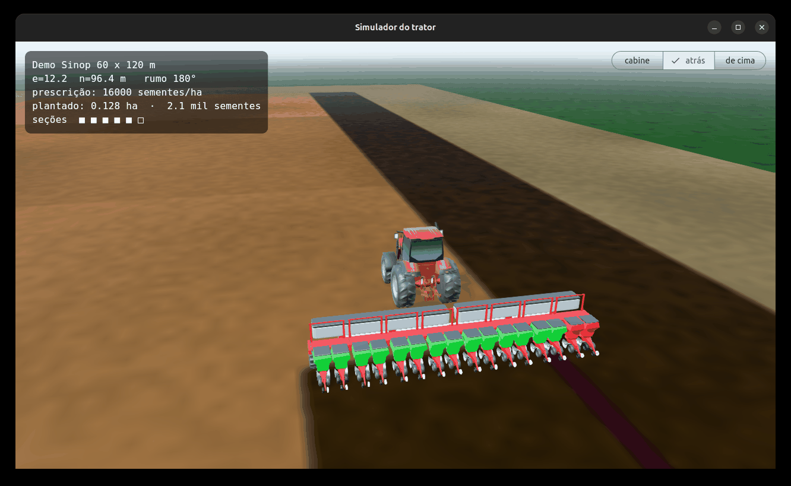

# Simulador e física

O [`apps/simulador`](https://github.com/jmfdev6/devfest-isobus-flutter/tree/main/apps/simulador) é o trator na rede. A cada 100 ms ele chama `agiso_trator_mover`, e a ponte transmite o GPS NMEA 2000, a velocidade de solo (`0xFE49`) e a rotação (EEC1). As seções vêm do que a plantadeira informa ao TC da cabine (a ponte fareja o *process data*); como ele mesmo é o trator, não recebe de volta o GPS que manda, e chama `TcAutomatico.aoGps` direto para pintar o chão.



## Física

[`fisica.dart`](https://github.com/jmfdev6/devfest-isobus-flutter/blob/main/apps/simulador/lib/fisica.dart), integrada a cada quadro:

| Constante | Valor |
|---|---|
| entre-eixos | 2,3 m |
| eixo traseiro → antena | 0,8 m |
| esterço máximo | 38° nas rodas |
| volante | 1,5 volta para cada lado |
| velocidade máxima | 18 km/h frente, 7 km/h ré |
| aceleração máxima | 1,2 m/s² (motor no máximo) |
| freio | 4 m/s² |
| motor | 850 (lenta) a 2200 rpm |

**Modelo de bicicleta** pelo eixo traseiro:

```text
δ   = volante / (1,5 · 360°) · 38°
ψ̇   = v / entreEixos · tan δ
ė   = v · sin ψ,   ṅ = v · cos ψ        (ψ = rumo a partir do norte, horário)
antena = eixo + 0,8 m · (sin ψ, cos ψ)
```

Raio mínimo de giro: 2,3 / tan 38° ≈ 2,9 m. O resto do passo (`passo(dt)`, com `dt` limitado a 50 ms para um quadro travado não virar um salto):

```text
acelerador = max(acelerador de mão, pedal)
rpm_alvo   = 850 + (2200 − 850) · acelerador
rpm       += (rpm_alvo − rpm) · (1 − e^(−2,5·dt))              // inércia do motor
carga      = (rpm − 850) / (2200 − 850)                        // < 2%: não puxa
tração     = 1,2 · (0,3 + 0,7·carga) · (1 − freio)             // só enquanto v < v_máx · carga
contra     = 0,35 + 0,01·v² + 4 · freio                         // solo solto, arrasto e freio
v         += (tração − sinal(v) · contra) · dt
```

Sem tração, a resistência **para** o trator, mas não o põe andando para o outro lado. Frente/ré só engata com o trator (quase) parado.

Autoteste: `cd apps/simulador && dart --enable-asserts lib/fisica.dart`.

## Controles

| Comando | Teclado | Tela | USB (`/dev/input/js0`) |
|---|---|---|---|
| volante | A/D, ←/→ (solto, volta ao centro) | volante arrastável | eixo 0 |
| acelerador | W, ↑ | — | eixo 5 (gatilho direito) |
| acelerador de mão | E põe, Q tira | alavanca | — |
| freio | S, ↓, espaço | — | eixo 2 (gatilho esquerdo) |
| frente/ré | R | botão F → R | botão 0 (A / X) |
| câmera | C | botões | botão 3 (Y / △) |

### Volante USB

[`controle_usb.dart`](https://github.com/jmfdev6/devfest-isobus-flutter/blob/main/apps/simulador/lib/controle_usb.dart) lê a **API de joystick do Linux** sem dependências: eventos de 8 bytes de `/dev/input/js0`.

| Bytes | Campo |
|---|---|
| 0–3 | tempo (ms, `u32`) |
| 4–5 | valor (`s16`, −32767 a 32767) |
| 6 | tipo: 1 = botão, 2 = eixo; bit `0x80` = estado inicial |
| 7 | número do eixo ou botão |

O mapeamento está nas constantes do topo do arquivo (`eixoVolante`, `eixoAcelerador`, `eixoFreio`, `botaoSentido`, `botaoCamera`, `pedalInvertido`). Para um volante com pedais (Logitech G29, por exemplo), descubra os números com `jstest /dev/input/js0` e ajuste. Sem joystick ou sem permissão de leitura, o simulador segue sem ele.

## Trabalhos

| Botão | Efeito |
|---|---|
| novo trabalho | encerra o atual e começa um mapa em branco |
| trabalhos | histórico do talhão (área, sementes, distância); **continuar** reabre um antigo |

O trabalho é salvo **a cada 10 s** e ao fechar. Ao abrir de novo, o simulador continua o trabalho aberto do talhão ativo.

## Painel

[`painel.dart`](https://github.com/jmfdev6/devfest-isobus-flutter/blob/main/apps/simulador/lib/painel.dart): o volante arrastável (acumula voltas, com pomo de manobra), velocímetro, conta-giros e marcha, e a alavanca do acelerador.
