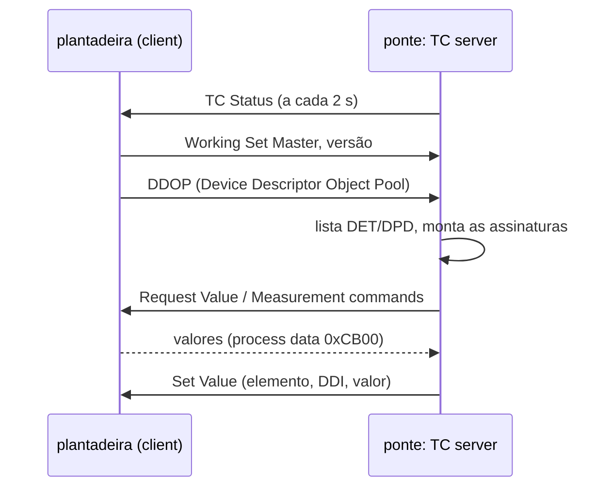

# Task Controller (TC)

O TC (ISO 11783-10) é o "gerente de tarefas": descobre o que o implemento sabe fazer, acompanha os valores dele e manda *setpoints*. A cabine é o TC *server* ([`nativo/ponte/tc.cpp`](https://github.com/jmfdev6/devfest-isobus-flutter/blob/main/nativo/ponte/tc.cpp)); a plantadeira é o TC *client*.

| Nível | O que faz | Onde |
|---|---|---|
| **TC-BAS** | totais e valores do implemento | `tc.cpp` (assinaturas, log) |
| **TC-GEO** | taxa conforme a posição e um mapa de prescrição | `TcAutomatico` (Dart) |
| **TC-SEC** | liga/desliga seções conforme a posição e a cobertura | `TcAutomatico` (Dart) |

O servidor C++ é mínimo de propósito: ele fala o protocolo. A **decisão** (qual taxa, quais seções) é tomada em Dart, onde estão o talhão, o mapa e a tela.

## Conexão



O implemento espera alguns segundos (exigência da norma) antes de falar com o TC: o VT conecta primeiro. Ao receber o DDOP, o servidor imprime os elementos (`DET`) e os dados (`DPD`) e, no ciclo seguinte, **assina** cada DPD: um *Request Value* ("quanto vale?") e um *Change Threshold* de 1 ("avise quando mudar"). A cada 2 s ele registra o que mudou, com o nome que o implemento deu a cada valor:

```text
TC  | DDOP recebido de 0x80: 1428 bytes
TC  | DET 3 Product
TC  |     DPD  DDI 11  Target Rate
TC  | assinei 17 valores
TC  | Target Rate (3/11) = 12000
TC  | Bin Level (3/78) = 150000
```

## DDIs usados

O DDOP da plantadeira de exemplo tem a barra no **elemento 2** e o produto no **elemento 3**.

| Elemento / DDI | Nome no DDOP | Direção | Uso |
|---|---|---|---|
| 3 / 11 | Target Rate | TC → implemento e volta | taxa alvo (TC-GEO). A demo trata o valor como sementes/ha. Vira o evento `AGISO_TAXA`. |
| 3 / 78 | Bin Level | implemento → TC | sementes no depósito (`AGISO_DEPOSITO`) |
| 3 / 79 | Bin Capacity | implemento → TC | capacidade do depósito |
| 2 / 160 | Section Control State | TC → implemento | `1` = automático (o TC manda nas seções), `0` = manual |
| 2 / 290 | Setpoint Work State 1-16 | TC → implemento | o que o TC quer de cada seção |
| 2 / 161 | Actual Work State 1-16 | implemento → TC | o que cada seção está fazendo de verdade (`AGISO_SECOES`) |
| 2 / 116 | Area Total | implemento → TC | área trabalhada |

### Estado das seções

DDI 161 e 290 são *condensed work states*: **2 bits por seção**, seção 1 nos bits menos significativos.

| Bits | Significado |
|---|---|
| `00` | desligada |
| `01` | ligada |
| `10` | erro |
| `11` | não existe / não disponível |

Exemplos com 6 seções (as 10 restantes em `11`):

| Valor (`int32`) | Hex | Seções |
|---|---|---|
| `-2731` | `0xFFFFF555` | ■■■■■■ todas ligadas |
| `-3755` | `0xFFFFF155` | ■■■■■□ a 6 desligada |
| `-4091` | `0xFFFFF005` | ■■□□□□ só 1 e 2 |
| `1365` | `0x00000555` | setpoint: ligar as 6 |

### Switches × TC

A plantadeira em [`nativo/plantadeira/`](https://github.com/jmfdev6/devfest-isobus-flutter/tree/main/nativo/plantadeira) é uma cópia do *seeder example* da AgIsoStack++ com duas mudanças:

1. **os switches acompanham as seções:** no automático, uma ordem do TC também move o switch da tela, e o operador pode cortar uma seção pelo switch. Vale a última ordem (no exemplo original, os switches eram ignorados no automático);
2. **consumo de semente:** o depósito (DDI 78) desce conforme `seções ligadas × largura × velocidade (0xFE49) × taxa`.

## TC automático (GEO + SEC)

[`TcAutomatico`](https://github.com/jmfdev6/devfest-isobus-flutter/blob/main/pacotes/agiso/lib/geo.dart), a cada evento `Gps`:

```text
1. p      = talhão.local(lat, lon)            // graus → metros (leste, norte)
2. barra  = engate.seguir(p, rumo)            // pose da barra rebocada
3. marcar(barra_anterior → barra)             // o que as seções LIGADAS plantaram
4. se ligado:
     GEO: taxa = talhão.taxa(centro da barra)
          se mudou → definirNoTc(3, 11, taxa)
     SEC: para cada seção i (centro, 1 m adiante):
            liga_i = talhão.dentro(s) && !mapa.coberto(s)
          se mudou → definirNoTc(2, 160, 1); definirNoTc(2, 290, Σ liga_i << 2i)
```

- **Por que 1 m adiante:** compensa a latência entre o pedido e a seção abrir ou fechar, e evita que a própria passada se marque como coberta.
- **Marcação pelo estado real:** o passo 3 usa as seções que o **implemento** informou (DDI 161), não as pedidas. O segmento entre duas poses é amostrado a cada meia célula, e cada seção é varrida na largura dela, então não ficam furos no mapa.
- **Cabeceira:** quando a barra sai do talhão, as seções cortam **uma a uma**, conforme cada centro cruza a divisa.
- **Sobreposição:** na volta, a seção que passaria por cima do plantado é cortada.

### O engate

A plantadeira é **rebocada**: gira em torno do pino do engate. O TC e o 3D usam o mesmo modelo (`Engate`), então o corte bate com o que se vê.

| Constante | Valor |
|---|---|
| antena → pino | 2,2 m |
| pino → linhas de plantio | 2,8 m (`Barra.recuo` 5 m − 2,2 m) |
| largura da barra | 9,144 m (30 pés), 6 seções de 1,524 m |

```text
pino   = antena − 2,2 m · (sin ψ, cos ψ)
barra' = pino − 2,8 m · (pino − barra) / |pino − barra|    // a barra é puxada pela reta pino-barra
rumo_barra = atan2(pino − barra)
```

É a discretização da **tractrix**: em reta, a barra fica 5 m atrás da antena; numa curva, corta por dentro do caminho do trator. Se o trator "pula" (mais de 1,5 × o cabeçalho), a barra é recolocada alinhada atrás dele.

## Testar

```bash
./scripts/teste_tc.sh     # DDOP, assinaturas, taxa alvo, seções, depósito
./scripts/teste_geo.sh    # GPS, taxa por zona, corte na cabeceira e na sobreposição
```

Ou à mão, na cabine em modo texto (`cd pacotes/agiso && dart run bin/main.dart vcan0`):

| Comando | Efeito |
|---|---|
| `t 3 11 20000` | taxa alvo 20 mil |
| `t 2 160 1` | seções em automático |
| `t 2 290 1365` | liga as 6 |
| `t 2 290 5` | só a 1 e a 2 |
| `b 6005` | aperta o switch da seção 6 |
| `g` | liga/desliga o TC automático |
| `l` | limpa o mapa (esquece o plantado) |
