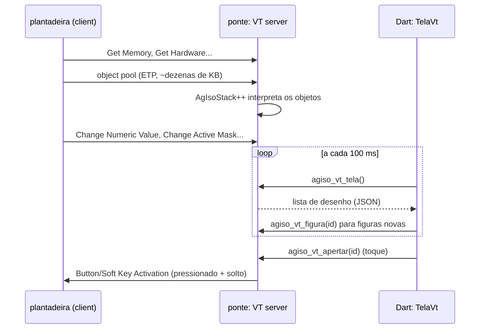

# Terminal Virtual (VT)

O VT (ISO 11783-6) é a tela universal da cabine: o **implemento** manda um *object pool* (a descrição de todas as telas, botões, textos e figuras dele) e o **terminal** desenha. A cabine é o VT *server*; a plantadeira (`seeder`) é o VT *client*.



## Do *object pool* à lista de desenho

[`nativo/ponte/vt.cpp`](https://github.com/jmfdev6/devfest-isobus-flutter/blob/main/nativo/ponte/vt.cpp) implementa o `VirtualTerminalServer` da AgIsoStack++ (área de dados de **480 × 480** px, 6 soft keys físicas de **80 × 80** px) e um `Pintor` que percorre a árvore de objetos da máscara ativa, recursivamente (até 32 níveis: *object pointers* podem formar ciclos), acumulando operações de desenho em coordenadas absolutas.

| Objeto VT | Vira |
|---|---|
| Data Mask, Alarm Mask, Key | `re` com a cor de fundo + filhos |
| Container | filhos (se não estiver oculto) |
| Object Pointer | o objeto apontado |
| Button | `re` de fundo, `re` de borda, filhos, `bt` (área de toque) |
| Output/Input String | `tx` (valor da *String Variable*, se houver) |
| Output/Input Number | `tx` com `(valor + offset) × escala`, casas decimais, truncar, zero em branco |
| Output/Input List | o item escolhido pela variável |
| Input Boolean | caixa marcada ou não + `bt` |
| Output Rectangle | `re` (linha, preenchimento, supressão de lados) |
| Output Ellipse | `el` (tipo e ângulos) |
| Output Line | `ln` (direção) |
| Output Meter | `me` (ponteiro, arco, marcas) |
| Picture Graphic | `pi` (pixels pedidos à parte) |

Textos do VT são **Latin-1**; a ponte converte para UTF-8. Números saem sempre com ponto decimal (o GTK põe o *locale* do sistema, que em pt-BR usaria vírgula).

## A lista de desenho

`agiso_vt_tela` devolve:

```json
{
  "ws": 128,
  "mascara": 1000,
  "lado": 480,
  "tecla": 80,
  "ops": [ {"t":"re","x":0,"y":0,"w":480,"h":480,"l":-1,"lw":0,"f":16777215,"ls":0}, ... ],
  "teclas": [ {"id":5000,"ops":[ ... ]}, ... ]
}
```

| Campo | Significado |
|---|---|
| `ws` | endereço do implemento dono da tela |
| `mascara` | ID da máscara ativa |
| `lado`, `tecla` | tamanho da área de dados e das soft keys, em px |
| `ops` | operações da máscara, na ordem de pintura |
| `teclas` | uma lista de operações por soft key, em coordenadas da tecla |

Toda operação tem `t` (tipo), `x`, `y`, `w`, `h`. Cores são inteiros `0xRRGGBB` já resolvidos pela paleta do implemento; `-1` = transparente / sem preenchimento.

| `t` | Campos extras |
|---|---|
| `re` retângulo | `l` cor da linha, `lw` espessura, `f` preenchimento, `ls` supressão de lados |
| `el` elipse | `l`, `lw`, `f`, `ty` tipo (fechada, aberta, segmento, setor), `a0`/`a1` ângulos em graus |
| `ln` linha | `c` cor, `lw`, `d` direção (0 = ↘, 1 = ↗) |
| `tx` texto | `s` texto, `c` cor, `fw`/`fh` tamanho da fonte, `st` estilo, `bg` fundo, `hj`/`vj` alinhamento, `wr` quebra de linha |
| `me` medidor | `min`, `max`, `v` valor, `nc` ponteiro, `ac` arco/marcas, `bc` borda, `ti` nº de marcas, `o` opções, `a0`/`a1` |
| `pi` figura | `id` (pixels por `agiso_vt_figura`) |
| `bt` área de toque | `id` do objeto a mandar em `agiso_vt_apertar` |

### Figuras

Os *Picture Graphics* são índices de cor por pixel (1, 4 ou 8 bits). A ponte converte cada figura **uma vez** (quando o objeto muda) para RGBA 8888 com a paleta do implemento.

!!! note "Transparência"
    Pixels da cor de transparência viram **os 4 bytes em zero**. O Flutter trata a imagem como alfa pré-multiplicado: um pixel com RGB ≠ 0 e alfa 0 seria **somado** ao fundo. Era isso que tapava os retângulos de status das seções em uma versão anterior.

## O lado Flutter

[`apps/cabine/lib/tela_vt.dart`](https://github.com/jmfdev6/devfest-isobus-flutter/blob/main/apps/cabine/lib/tela_vt.dart):

- um `Timer` de **100 ms** lê o JSON; se a string não mudou, não há `setState`;
- figuras novas são pedidas e decodificadas com `decodeImageFromPixels` e guardadas por ID;
- um `CustomPainter` escala a área de 480 px para o espaço disponível e executa as operações; as soft keys ficam numa coluna à direita;
- um `GestureDetector` testa o toque contra as áreas `bt` (da última para a primeira, para o objeto de cima ganhar) e chama `agiso_vt_apertar`.

O toque vira **duas mensagens** ao implemento: pressionado e solto. Para *Input Boolean*, a ponte inverte o valor e manda um *Change Numeric Value* da variável.

## Limitações conhecidas

- padrões de preenchimento (*fill pattern*) viram cor sólida;
- fontes são aproximadas pela fonte monoespaçada do Flutter no tamanho pedido;
- não há *Input* de texto ou número por teclado na tela (só toques), nem *Auxiliary Control*;
- a cabine mostra a tela de um implemento por vez.
